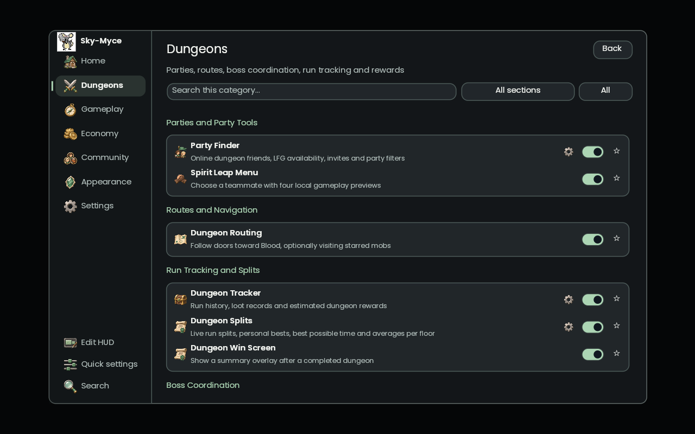
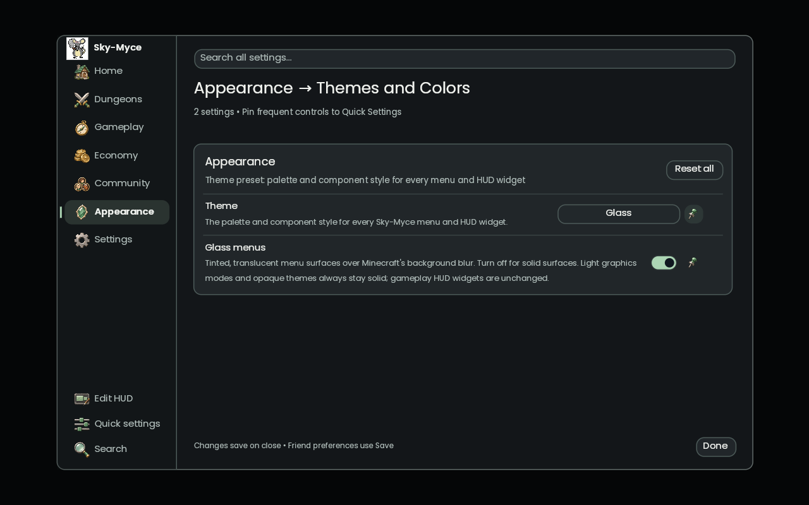

# Glass menu contribution

New installations use **Glass**, a graphite palette with mint accents. **Appearance → Glass menus** is enabled by default; turning it off produces solid menu surfaces. Existing saved palettes and legacy theme migration are preserved. Opaque palettes, High contrast and the two Light graphics modes remain solid, without requesting background blur. The switch does not change gameplay HUD opacity or Minecraft's own settings.

## Captures from the offline Minecraft client

These capture the running Skija menus, not generated concepts. The fixture has no world behind it; in-world background blur still needs gameplay review.

[Solid version of the same dungeon menu](design/menus/solid.png)

## Design references

- [Apple: Materials](https://developer.apple.com/design/human-interface-guidelines/materials) — distinguish navigation from content through material, while keeping text legible.
- [Microsoft Fluent 2: Material](https://fluent2.microsoft.design/material) — tinted translucent surfaces for transient menus.
- [Microsoft: Acrylic](https://learn.microsoft.com/en-us/windows/apps/design/style/acrylic) — avoid multiple competing translucent layers and provide a solid alternative.

The implementation uses one translucent outer shell with stronger control surfaces, restrained highlights, custom painted PNG icons and no accent glow in the Glass preset. It is a tinted material over Minecraft's existing background blur, not a refraction shader. If the player disables Minecraft's blur, only tint and transparency remain.

## Rendering and assets

- Custom menu drawing stays on the existing Skija/Skia GPU renderer and Minecraft OpenGL context. Minecraft and owo retain layout, input, focus and narration. The existing Java2D compatibility renderer is retained.
- Poppins Regular and SemiBold are bundled from [Google Fonts](https://github.com/google/fonts/tree/main/ofl/poppins), with the SIL Open Font License in `src/main/resources/assets/skymyce/font/poppins-ofl.txt`. Native painting uses the actual SemiBold face instead of synthetic bold. Native and compatibility renderers both measure the faces they draw.
- The original 512 × 530 `icon.png` is unchanged. The navigation header samples it directly, preserves its aspect ratio and never creates a smaller intermediate logo. Native PNG drawing uses linear sampling; compatibility drawing uses bicubic interpolation. Existing physical-window-resolution menu rendering is retained.
- Navigation, feature and utility buttons use an original 20-icon PNG atlas: jade, steel and parchment illustrations. Feature-specific maps, party portraits, chests and scrolls replace repeated category symbols in the dungeon directory. The original logo remains unchanged. [Asset generation prompts](design/menus/icon-prompts.md) record the built-in imagegen workflow.
- The PNG and source rectangles are under `src/main/resources/assets/skymyce/textures/ui/menu-icons.*`. The atlas is decoded once and its source views retained; Skia samples the PNGs with linear filtering at window resolution. Disabled controls retain their fade alpha, selected utility controls have a filled highlight, and there are no icon shape paths or SVG dependencies.

## Verification

Run `./gradlew check`. The checks cover solid fallbacks, palette contrast, saved theme migration, PNG interpolation, native primitives and font metrics. Run `./gradlew skijaGpuCheck` for the desktop OpenGL composition/state-restoration check.

`SKYMYCE_GUI_SCENE_PREFIX=dungeons- ./gradlew runGuiVisualCheck` captures the glass and solid dungeon directories. `SKYMYCE_GUI_SCENE_PREFIX=themes-glass ./gradlew runGuiVisualCheck` captures the appearance controls. Output is under `build/gui-visual-check/screenshots`. These are isolated offline client scenes; gameplay HUD transparency remains outside this change.

Local verification on Linux/NVIDIA OpenGL: `check` and `skijaGpuCheck` passed. The dungeon-only and glass-appearance captures also passed and exited cleanly. The full visual run captured 80 images and completed its browser assertions, then aborted during native shutdown with exit 134 (`free(): invalid pointer`). The cause of that shutdown failure has not been established; it is not reported as a passing full visual run.
