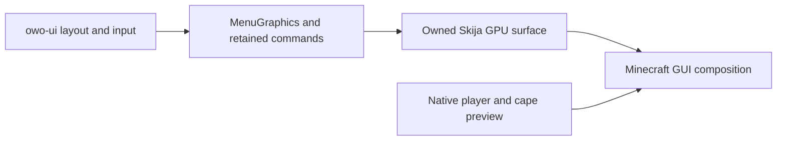

# Skija GUI implementation plan

Prepared 13 October 2026 against Sky-Myce 2.5.0, commit `43748d9`.
Target: Minecraft 26.1.2, Fabric and Java 25.

**Status: proposed.** This document plans the renderer migration; implementation
and runtime compatibility have not been tested.

## Goal and approach

Replace the custom Java2D/AWT menu rasterizer with Skija GPU rendering while
retaining owo-ui layout and input, Resourceful Config settings, the current menu
design, accessibility options and navigation behavior. The intended improvement
is lower CPU cost and fewer pixel uploads during menu animation. Measure that
improvement before selecting Skija as the production default.

Use an owned offscreen GPU surface and let Minecraft compose its texture into
the GUI. Keep the existing AWT renderer available for recoverable initialization
failures and unsupported platforms. Start with screens inheriting `MenuScreen`;
the HUD, IRC media viewer and world overlays keep their current rendering paths.
Native player/cape previews remain a separate Minecraft rendering pass.



Skija offers raster and OpenGL surfaces. Its raster surface is useful for
headless drawing fixtures; production GPU drawing should retain the finished
image on the GPU through composition. [Skija getting-started guide](https://github.com/HumbleUI/Skija/blob/master/docs/Getting%20Started.md)

## Current implementation and change locations

| Location | Role in the migration |
| --- | --- |
| [MenuCanvas.kt](D:/Code/Sky-Myce/src/main/kotlin/me/mycellium/skymyce/ui/MenuCanvas.kt) | Retained paint commands, AWT rasterization, damage tracking, snapshots, transitions and font caches. Preserve the command model and replace its drawing backend. |
| [MenuGraphics.kt](D:/Code/Sky-Myce/src/main/kotlin/me/mycellium/skymyce/ui/MenuGraphics.kt) | Adapts owo drawing, transforms, clipping and formatted text to the canvas. Keep its component-facing behavior. |
| [MenuScreen.kt](D:/Code/Sky-Myce/src/main/kotlin/me/mycellium/skymyce/ui/MenuScreen.kt) | Extracts the UI, applies quality/resolution limits, transfers snapshots between screens and composes the final texture. Own renderer selection and lifecycle here. |
| [MenuTexture.kt](D:/Code/Sky-Myce/src/main/kotlin/me/mycellium/skymyce/ui/MenuTexture.kt) | Uploads AWT pixels and retires resources after extracted GUI frames finish using them. Reuse its lifetime rules for GPU resources. |
| [MenuUi.kt](D:/Code/Sky-Myce/src/main/kotlin/me/mycellium/skymyce/ui/MenuUi.kt), [MenuTextBox.kt](D:/Code/Sky-Myce/src/main/kotlin/me/mycellium/skymyce/ui/MenuTextBox.kt) | Text wrapping, styled hover regions, caret placement and selection use canvas metrics. Update them together with text drawing where necessary. |
| [MenuItem.kt](D:/Code/Sky-Myce/src/main/kotlin/me/mycellium/skymyce/ui/MenuItem.kt), [MenuSkullArt.kt](D:/Code/Sky-Myce/src/main/kotlin/me/mycellium/skymyce/ui/MenuSkullArt.kt) | Existing image/skin preparation can remain; convert and cache those images for Skija at the rendering boundary. |
| [ThemeConfig.kt](D:/Code/Sky-Myce/src/main/kotlin/me/mycellium/skymyce/config/misc/ThemeConfig.kt) | Preserve saved graphics quality, motion mode, colors and introduction state. |
| [build.gradle.kts](D:/Code/Sky-Myce/build.gradle.kts), [gradle.properties](D:/Code/Sky-Myce/gradle.properties) | Pin dependencies, package native libraries and register focused executable checks. |

The current renderer already skips unchanged rasterization/uploads, reuses
commands and bounds its caches. Preserve those benefits. The historical card
flicker was tied to hover geometry following its animated pose; renderer work
must preserve logical hover ownership and transformed child input. See the
[existing menu measurements](D:/Code/Sky-Myce/docs/menu-optimization-2026-10.md).

## 1. Capture a baseline

Run the existing canvas benchmark and record complete Minecraft frame timings
on the same machine, resolution, GUI scale, mod set, quality and motion settings
that will be used for the Skija comparison.

- Capture idle Home, stationary hover at the reported card edges, category
  transitions, settings scrolling, text entry and dropdowns.
- Include Light, Medium, Heavy, Reduced and Off motion, plus every graphics
  quality. Save screenshots for matching visual comparisons.
- Record warmed median/p95 frame times, GUI CPU time, Java allocation, process
  memory and available GPU/resource counters. Separate cold native/font loading
  from recurring frame costs; repeat representative measurements three times.
- Use the existing `RuntimeProfiler` and its credential-safe JFR configuration.
  Its GUI measurement covers extraction; a deferred Skija flush must also be
  measured so work moved later in the frame is still counted.

**Exit condition:** a reproducible baseline and a fixed comparison scenario.
Headless canvas timings alone do not establish game FPS or GPU performance.

## 2. Prove the GPU bridge and packaged dependency

Create a small development prototype before porting the full canvas. Prefer
direct HumbleUI Skija with one narrow Minecraft integration layer. Resolve
`0.143.17` as an initial candidate, verify the required published artifacts and
pin the version accepted by the prototype. Check APIs against that version:
the upstream changelog includes changes to context reset and texture APIs.
[Skija changelog](https://github.com/HumbleUI/Skija/blob/master/CHANGELOG.md)

Inspect the mapped Minecraft 26.1.2 rendering classes to identify the actual
render-phase hook, GPU texture/view wrapping and graphics-state invalidation
mechanisms. Do not assume drawing into a GUI extraction callback is equivalent
to drawing at the final composition stage.

The prototype must demonstrate:

1. An owned offscreen texture, a Skija GPU surface, one rounded rectangle and
   one text run composed through Minecraft's GUI at the correct position/depth.
2. Correct alpha, texture orientation, color space and scaling over a world.
   Define premultiplied-alpha handling explicitly at the texture boundary.
3. Writes complete before Minecraft samples the texture. Deferred work retains
   immutable commands and valid resources until consumption.
4. Minecraft and Skija both see valid graphics state after drawing. Account for
   engine state caches as well as framebuffer, viewport, scissor, blend,
   depth/stencil, program and texture bindings actually touched by the bridge.
5. Rendering, resize and disposal occur on the required client/render thread.
   Closing the GUI leaves the world, vanilla menus and HUD rendering correctly.

[BlackSkija](https://github.com/DreamcastERA1/BlackSkija) is an integration
reference with a Minecraft 26.1.2 OpenGL target. Its current dependency
requirements and runtime native download policy differ from this project's;
evaluate a compatible pinned revision before considering it as a dependency.
Use it only if it reduces integration code while satisfying offline packaging
and resource ownership requirements.

Package platform natives from pinned dependencies inside the signed release
where practical. Verify Windows x64 first, then each supported Linux/macOS and
ARM target for which the chosen version publishes binaries. Test the actual
packaged Fabric JAR under Prism, including a cold offline launch and Java 25
native access requirements. Record artifact size and license notices.
Skija publishes platform-specific artifacts. [Skija dependency documentation](https://github.com/HumbleUI/Skija/blob/master/README.md)

**Exit condition:** the packaged prototype renders and survives resize/close
without corrupting Minecraft rendering. Keep AWT active if this bridge cannot
be demonstrated. Native process crashes cannot be repaired by an in-process
fallback; compatibility testing is required before default activation.

## 3. Port canvas drawing and text together

Reuse the retained commands, transforms, clipping, opacity and revision model.
Add only the backend boundary needed for Skija and the existing AWT fallback;
avoid a general renderer/plugin framework.

Port rectangles, rounded borders, arcs/rings, lines, gradients, pictures and
formatted text. Match the current design first. Preserve Lato, bold/italic,
underlines, Unicode fallback and existing Minecraft text styles/bidi ordering.
Full paragraph reshaping and new visual effects can be evaluated separately.

Text drawing and measurement must share the same font/fallback/advance policy.
Audit every `MenuCanvas.textWidth` and `lineHeight` caller: labels, tooltips,
dropdown rows, wrapping, text boxes, caret/selection and styled link hit tests.
If the active backend changes, invalidate dependent measurements and relayout.
Avoid retaining AWT advances while Skija draws different glyph positions.

Convert prepared item/skin images once per bounded cache entry. Adopt new
native image resources on the rendering thread and preserve the existing async
generation checks. Keep Minecraft-owned images/textures under Minecraft's
ownership. Define ARGB/RGBA and straight/premultiplied conversion explicitly.

**Exit condition:** a representative settings page has coherent drawing,
wrapping, tooltips, text input and hit testing at every supported scale.

## 4. Preserve transitions, idle caching and resource lifetime

Move page/tooltip/modal snapshots and transition blending to bounded Skija
images or surfaces. Preserve interruption, reversal, cross-screen ownership and
the existing motion modes. Release outgoing snapshots when their transitions
finish. Keep native avatar/cape previews in their current settled-page pass.

Retain an unchanged-frame fast path that reuses the completed texture. Damage
tracking may guide partial drawing only when the GPU bridge supports it
correctly; prefer correct redraw on actual changes over unsafe partial clears.
Keep graphics-quality resolution limits and bounded font/image caches.

Resource mutation and disposal must respect extracted frames still awaiting
rendering. Reuse the existing after-tick/fenced retirement approach where
valid, and verify the bridge's GPU ordering. Introduce extra frame buffers only
if the prototype proves they are necessary. Cover resize, quality changes,
resource reload, navigation, context replacement and client shutdown.

Select a backend once at a safe initialization boundary. On a recoverable
native/context initialization failure, emit one actionable diagnostic and use
AWT with consistent metrics. Avoid retrying initialization every frame or
adding another user-facing renderer setting for the initial migration.

**Exit condition:** repeated navigation and resizing remain stable, resources
return to their settled bounds, and idle menus trigger no unnecessary redraw.

## 5. Verify behavior and measure the result

Extend the existing executable checks rather than adding a test framework.
Keep AWT pixel-parity checks for the fallback. Use Skija raster fixtures for
deterministic drawing tests, with backend-appropriate expectations for text
edges instead of requiring identical Java2D antialiasing pixels. Test clipping,
alpha/orientation, transforms, snapshots, font fallback, caret/hit alignment,
cache bounds and deferred retirement. GPU ordering needs native-client tests.

With Java 25, run focused checks while iterating:

```powershell
.\gradlew.bat hudCheck menuMotionCheck menuNavigationCheck menuCatalogCheck menuShortcutsCheck runtimeProfilerCheck --console=plain
.\gradlew.bat menuCanvasBenchmark --console=plain
```

Register a focused Skija check in `check` for any new nontrivial drawing or
lifetime logic. Headless CI can exercise raster/pure logic; GPU checks require
a compatible graphics context and must be reported separately.

The native comparison matrix should cover:

- Home/category/settings/search navigation, tooltips, nested dropdowns, sliders,
  color controls, text selection, keyboard focus and clipboard behavior.
- Stationary hover at card edges, interrupted transitions and fast navigation;
  logical hit ownership must remain stable during painted movement.
- Each motion/quality mode, windowed/fullscreen resize, GUI scale changes and
  resource reload, including native cosmetics previews.
- The installed mod set; separately check relevant rendering mods if supported.
  Repeat screen open/close and resize cycles and inspect Java/native/GPU memory.
- Recoverable native-load/context failures, an unsupported platform and cold
  offline startup, with local features and personal data still usable.

Repeat the baseline scenarios and include deferred GPU work in the comparison.
Accept the default switch only when visual/input parity is established, resource
lifetime checks pass, and active-menu CPU improvement exceeds run-to-run noise
without worsening complete-frame p95 or settled idle cost. Record cold startup,
native/GPU memory and package-size costs alongside any gains.

**Exit condition:** full `check` passes, native evidence covers the affected
paths, and the report distinguishes measured improvements from assumptions.

## 6. Release after implementation passes

Run Java 25 `check build` with a new release version. Review packaged native
artifacts, dependency/license metadata and the fallback's cold offline behavior.
Document tested OS/GPU combinations and remaining compatibility limits.

Follow the authorized release workflow: upload the private artifact before its
signed protocol-4 Fabric manifest, activate `releases/community-current.json`
on the production backend, and verify the live signature and artifact hash.
Retain previous releases for rollback and push the implementation plus its
verification report. Keep runtime data and operator credentials outside Git.
The implementation remains a client renderer change; backend source changes
are unnecessary for it.

## Decisions still to validate

- Exact compatible Skija version and packaged native platform coverage.
- The safe Minecraft texture bridge and render hook for 26.1.2.
- Whether a compatible BlackSkija revision is smaller than a direct bridge.
- Performance, startup and native/GPU memory costs on real hardware.

The requested planning work creates this Markdown document only. Dependency
installation, renderer implementation, benchmarks and deployment belong to a
later implementation task.
